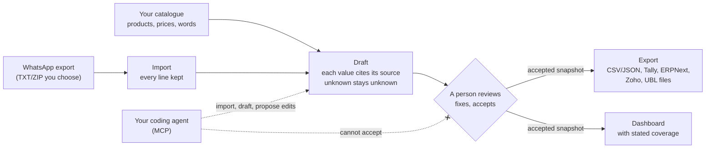
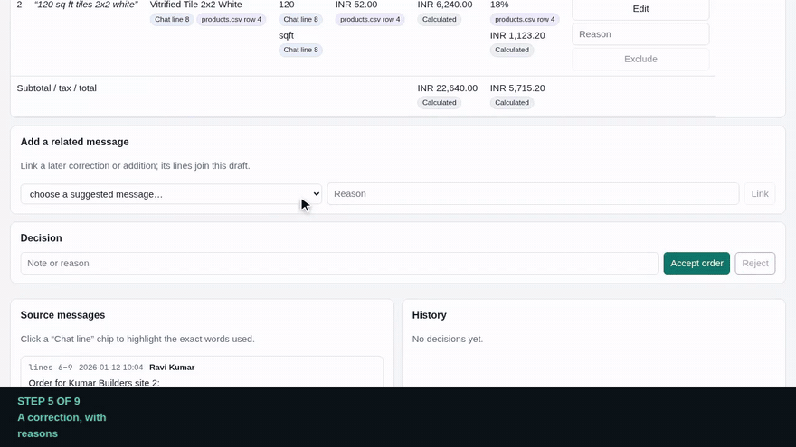
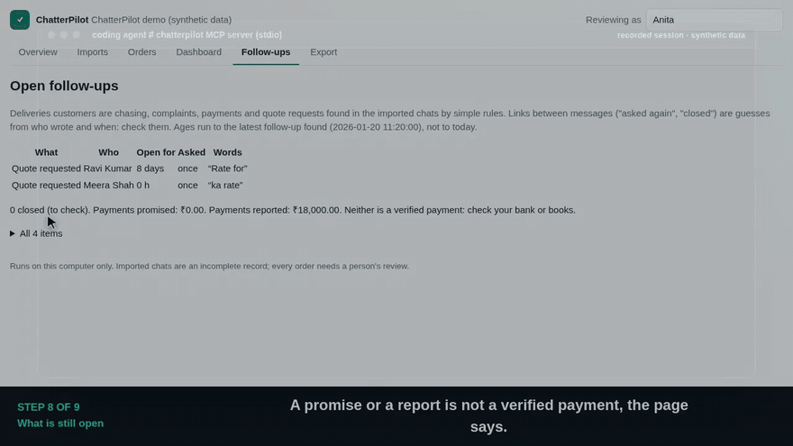
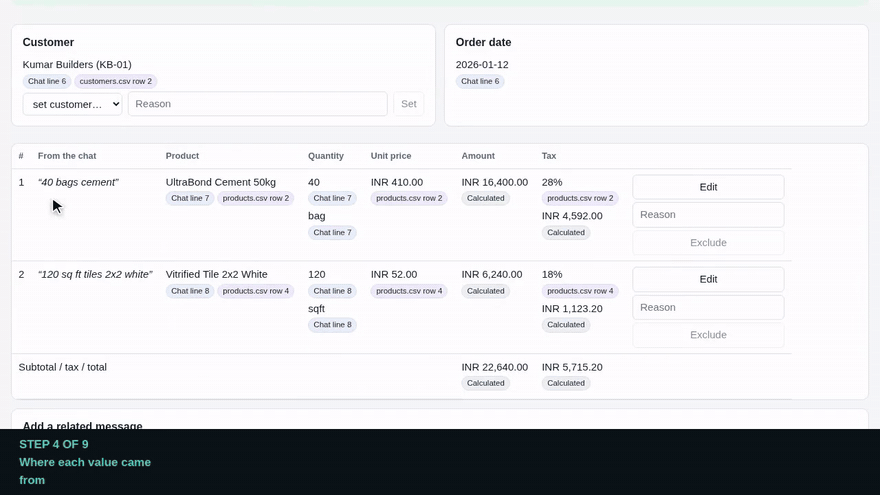
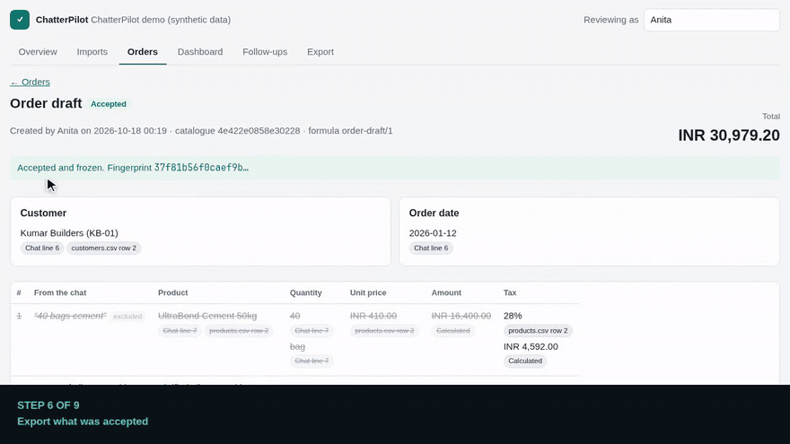
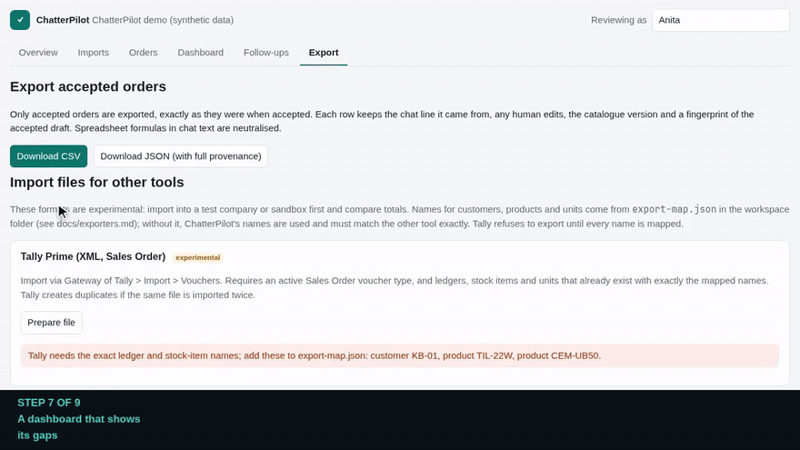

https://github.com/user-attachments/assets/8d0de102-f271-46f9-93e5-22ced205c35a

# ChatterPilot

**Turn WhatsApp order messages into source-linked drafts you can check and export.**

Many small businesses take orders, corrections and payment updates in WhatsApp groups. Someone then
re-types them into a spreadsheet, billing tool or ERP. ChatterPilot reads a chat export you choose,
proposes order drafts using your own price catalogue, shows exactly where every value came from,
and lets a person correct and accept them before anything is exported.

It runs on your computer. The core needs no account, no API key and no internet connection.
Run a shop rather than code? Start with [docs/for-shops.md](docs/for-shops.md) and
[docs/privacy.md](docs/privacy.md).

<p align="center">
  
</p>

**▶ [Watch the walkthrough with music](docs/media/tour.mp4)** (about 4 minutes, invented data) ·
[interactive tour](https://shekibahmed.github.io/ChatterPilot/media/tour.html) with chapters, clickable captions and copy-paste agent setup
(`pnpm media:tour` runs it locally) · [how the videos are made](docs/media/README.md)

<!-- Owner: after the repository is public, drag docs/media/tour.mp4 into this file in GitHub's web
editor and put the https://github.com/user-attachments/assets/... URL it creates on the next line,
on its own, for an inline player. See docs/media/README.md. -->

> **Status: early private prototype.** The parts below are built and tested on synthetic data.
> Nothing has been piloted with a real business yet, and no time-saving claims are made.
> See [docs/why.md](docs/why.md) for the problem and the design principles, and
> [docs/patterns.md](docs/patterns.md) for the ten patterns behind it, each with its source and
> the test that proves it.
> [docs/how-it-was-built.md](docs/how-it-was-built.md) describes the method: research, small
> tested slices, independent evaluation sets and adversarial review with AI agents.

**A starting kit for your coding agent.** ChatterPilot is small, tested, readable code for a
pattern many businesses need: messy messages in, checked records out, with a person in charge.
Use it as it is, or point Claude Code, Codex, Cursor or your own agent at it to fit your shop's
words, your billing tool and your workflow. The tests keep the safety rules in place while you
change things. See [docs/harnesses.md](docs/harnesses.md).

## How it works



## What it does today

| Step | What happens | Safeguards |
|---|---|---|
| Import | Reads WhatsApp TXT or ZIP exports (Android and iOS formats). | Every line is accounted for; ambiguous day/month order must be confirmed; hostile ZIPs (path tricks, symlinks, zip bombs) are refused; identical re-imports change nothing; the original text is kept byte-for-byte. |
| Voice notes | `chatterpilot transcript add` attaches a transcript you already have to a voice note; it is versioned and can then be drafted like text. | Values from a transcript are labelled "voice note", never passed off as typed chat. No automatic transcription yet. |
| Suggest | Messages mentioning products from your catalogue become order suggestions. | Suggestions only. Messages that read as payments, deliveries or quotes (English keyword rules) are not suggested. A message can belong to only one live draft. |
| Draft | Products, quantities and units are matched to your `products.csv`; prices and tax come only from the catalogue; totals use exact integer arithmetic. | Unknown values stay unknown. Typos, ambiguous names, stale or missing prices and incompatible units are flagged, never guessed. |
| Review | A person can set the customer, fix any field, exclude a line or link a later correction. | Every edit needs a reason and is kept in an append-only history. A draft with open issues cannot be accepted. |
| Dashboard | Order value by day, chat activity, pipeline, quantities by product, orders by customer and open review work. | Money figures count accepted orders only unless you choose otherwise; every metric states its definition, date coverage and what it left out; trends are refused ("insufficient comparable data") when coverage or volume is too thin. |
| Export | Accepted orders download as CSV or JSON, or as import files for Tally Prime, ERPNext, Zoho Books and UBL 2.1 ([docs/exporters.md](docs/exporters.md)). | Exports come from frozen, fingerprinted snapshots; spreadsheet formula injection is neutralised. Import files are marked experimental (not yet tried in the real tools); Tally refuses to export until every name is mapped. |
| Fill a form (opt-in, synthetic only) | `chatterpilot fill-form --approve` types an accepted order into a local synthetic web form (MockBooks) and reads it back. No real system is supported yet. | Approval bound to the exact document, prices, target, person and expiry; checked before and after saving; never twice; unknown outcomes reconciled, not retried; **stops before Submit**. See [docs/order-automation.md](docs/order-automation.md). |

### See it in motion

| A correction, with reasons | A coding agent, with limits |
|---|---|
|  |  |

<details>
<summary>More clips: where each value came from, export, dashboard</summary>

| Where each value came from | Export what was accepted | A dashboard that shows its gaps |
|---|---|---|
|  |  |  |

Still images: [draft review](docs/images/draft-review.png), [dashboard](docs/images/dashboard.png),
[export](docs/images/export.png).
</details>

## Try the demo

Requires Node.js 26+ and pnpm 12.

```sh
pnpm install --frozen-lockfile
pnpm demo
```

No Node.js on your machine? Open the repository in a dev container (VS Code "Reopen in Container",
or GitHub Codespaces once the repository is public): [.devcontainer](.devcontainer/devcontainer.json)
installs everything and runs the checks; then run `pnpm demo` inside it.

Open http://127.0.0.1:4317. The demo uses invented chats and an invented hardware-store catalogue
(see [fixtures/synthetic](fixtures/synthetic)). Try drafting the Kumar Builders order, then link the
"make it 45 bags" correction and exclude the old line.

## Use it with your own export

```sh
pnpm chatterpilot init --timezone Asia/Kolkata --name "My shop"
pnpm chatterpilot catalogue check path/to/catalogue     # products.csv, customers.csv, catalogue.json
pnpm chatterpilot catalogue load path/to/catalogue
pnpm chatterpilot import "WhatsApp Chat with Orders.zip"
pnpm chatterpilot serve                                  # http://127.0.0.1:4317
```

Other commands: `parse` (preview an export without storing it), `draft` (print suggested drafts
in the terminal) and `events --vehicles vehicles.csv` (a second, fleet/travel template: bookings,
changes, cancellations, vehicle faults, repair quotes and reported payments, with links between
them; see [fixtures/synthetic/fleet](fixtures/synthetic/fleet)) and `followups` (a third template:
deliveries being chased, short or damaged supplies, payment promises and reports, quote requests,
and what is still open). Run `pnpm chatterpilot` for help. The catalogue format is described in
[docs/catalogue.md](docs/catalogue.md).

Only import chats you have the right to process. Workspaces live in `workspaces/` (ignored by Git).

## Use it with your coding agent

ChatterPilot includes an MCP server, so agents can import exports, prepare drafts and propose
edits. They cannot accept orders: that tool does not exist, so a person always decides. In this
repository Claude Code picks up [`.mcp.json`](.mcp.json) automatically. Configs for Codex, Cursor
and VS Code, the tool list and recipes for extending the code are in [docs/harnesses.md](docs/harnesses.md).
Every CLI command also takes `--json`. There is an agent skill in
[skills/whatsapp-operations](skills/whatsapp-operations/SKILL.md).

**If you are an agent** (or briefing one): start with [llms.txt](llms.txt) and
[docs/agents/README.md](docs/agents/README.md). [docs/problems.md](docs/problems.md) maps each
business problem to the code and the test that solves it, the recipes in
[docs/agents/recipes](docs/agents/recipes) walk through common extensions, and
[docs/agents/tools.json](docs/agents/tools.json) and [docs/agents/errors.md](docs/agents/errors.md)
are generated from the code (a test fails if they drift). `pnpm check:quick` runs lint, types and
only the tests affected by your change.

## Supported and not supported (yet)

- **Tested export formats:** Android `dd/mm/yy, h:mm am - Name: text` and its variants (24-hour,
  dots, year-first, `a.m./p. m.`), iOS `[dd/mm/yy, h:mm:ss AM] Name: text`, with the special spaces and
  direction marks recent exports contain. Other locales may work but are untested.
- **Language:** order lines in English and romanised Hindi (Hinglish): unit words such as *bori,
  peti, nag, darjan*, number words such as *do, pachas, dedh, sawa do*, and digits in Devanagari,
  Bengali, Gujarati, Tamil and other scripts. Quantities written in words are always flagged for a
  person to confirm. Add your shop's own words in `lexicon.json` ([docs/catalogue.md](docs/catalogue.md)).
  Other languages need native-speaker evaluation first.
- **Telegram:** `chatterpilot intake` applies the staff-only intake rules to saved Telegram updates
  offline. There is no live bot yet.
- **Not included:** live WhatsApp connection, a live Telegram bot, automatic voice-note transcription, AI
  extraction (only the offline consent/validation boundary exists), any real (non-synthetic) target
  system, and document submission. These are planned as separate, opt-in,
  permission-gated steps.

## How it is built

TypeScript monorepo: `packages/import-whatsapp` (parser, safe ZIP), `packages/storage` (SQLite,
content-addressed files), `packages/orders` (catalogue, lexicon, matching, drafts), `packages/core`
(money, CSV, provenance), `packages/exporters` (import files for other tools),
`packages/templates` (fleet), `packages/order-automation` (approvals, ledger, form connector),
`packages/telegram-intake`, `packages/providers` (AI boundary, offline) and `apps/local` (CLI, MCP
server, loopback API, React review app). Design decisions are
recorded in [DECISIONS.md](DECISIONS.md); progress and test evidence in [PROGRESS.md](PROGRESS.md).

```sh
pnpm check      # lint + typecheck + unit/integration tests
pnpm test:e2e   # browser test of the demo (Playwright)
```

## Roadmap and helping

What comes next and what each step is waiting for (pilots, real test companies, native speakers) is
in [docs/roadmap.md](docs/roadmap.md). Contributions: [CONTRIBUTING.md](CONTRIBUTING.md).

**Feedback is the most useful contribution right now.** Run the demo or point your coding agent at
the repository, then tell us what you tried and what got in the way with the "Tell us how you use
it" issue form (invented examples only, never real chats). Starter tasks for people and agents are
in [docs/agents/tasks.md](docs/agents/tasks.md). If the patterns or the code saved you work, a star
helps other developers find it.

## Licence

MIT © 2026 Shekib Ahmed. See [LICENSE](LICENSE). Third-party packages keep their own licences; see
[THIRD_PARTY_NOTICES.md](THIRD_PARTY_NOTICES.md).
