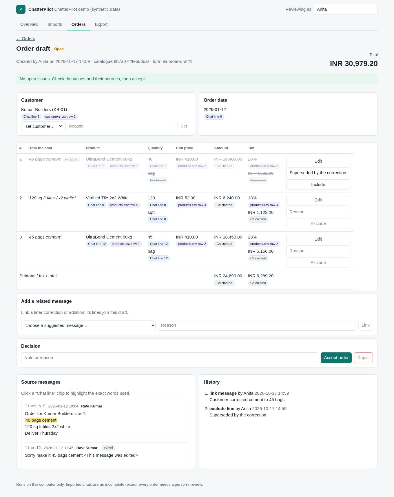

# ChatterPilot

**Turn WhatsApp order messages into source-linked drafts you can check and export.**

Many small businesses take orders, corrections and payment updates in WhatsApp groups. Someone then
re-types them into a spreadsheet, billing tool or ERP. ChatterPilot reads a chat export you choose,
proposes order drafts using your own price catalogue, shows exactly where every value came from,
and lets a person correct and accept them before anything is exported.

It runs on your computer. The core needs no account, no API key and no internet connection.



> **Status: early private prototype.** The parts below are built and tested on synthetic data.
> Nothing has been piloted with a real business yet, and no time-saving claims are made.
> See [docs/why.md](docs/why.md) for the problem and the design principles.

## What it does today

| Step | What happens | Safeguards |
|---|---|---|
| Import | Reads WhatsApp TXT or ZIP exports (Android and iOS formats). | Every line is accounted for; ambiguous day/month order must be confirmed; hostile ZIPs (path tricks, symlinks, zip bombs) are refused; identical re-imports change nothing; the original text is kept byte-for-byte. |
| Suggest | Messages mentioning products from your catalogue become order suggestions. | Suggestions only. Quotes, payments and delivery updates are not treated as orders. |
| Draft | Products, quantities and units are matched to your `products.csv`; prices and tax come only from the catalogue; totals use exact integer arithmetic. | Unknown values stay unknown. Typos, ambiguous names, stale or missing prices and incompatible units are flagged, never guessed. |
| Review | A person can set the customer, fix any field, exclude a line or link a later correction. | Every edit needs a reason and is kept in an append-only history. A draft with open issues cannot be accepted. |
| Export | Accepted orders download as CSV or JSON. | Exports come from frozen, fingerprinted snapshots; spreadsheet formula injection is neutralised. |

## Try the demo

Requires Node.js 26+ and pnpm 12.

```sh
pnpm install --frozen-lockfile
pnpm demo
```

Open http://127.0.0.1:4317. The demo uses invented chats and an invented hardware-store catalogue
(see [fixtures/synthetic](fixtures/synthetic)). Try drafting the Kumar Builders order, then link the
"make it 45 bags" correction and exclude the old line.

## Use it with your own export

```sh
pnpm chatterpilot init --timezone Asia/Kolkata --name "My shop"
pnpm chatterpilot catalogue check path/to/catalogue     # products.csv, customers.csv, catalogue.json
pnpm chatterpilot catalogue load path/to/catalogue
pnpm chatterpilot import "WhatsApp Chat with Orders.zip"
pnpm chatterpilot serve                                  # http://127.0.0.1:4317
```

Other commands: `parse` (preview an export without storing it) and `draft` (print suggested drafts
in the terminal). Run `pnpm chatterpilot` for help. The catalogue format is described in
[docs/catalogue.md](docs/catalogue.md).

Only import chats you have the right to process. Workspaces live in `workspaces/` (ignored by Git).

## Supported and not supported (yet)

- **Tested export formats:** Android `dd/mm/yy, h:mm am - Name: text` and its variants (24-hour,
  dots, year-first, `a.m./p. m.`), iOS `[dd/mm/yy, h:mm:ss AM] Name: text`, with the special spaces and
  direction marks recent exports contain. Other locales may work but are untested.
- **Language:** order lines are understood in English with Western digits. Hindi digits and unit
  words are skipped rather than guessed. Regional-language support needs proper evaluation first.
- **Not included:** live WhatsApp connection, voice-note transcription, AI extraction, dashboards,
  Telegram intake and filling forms in other systems. These are planned as separate, opt-in,
  permission-gated steps.

## How it is built

TypeScript monorepo: `packages/import-whatsapp` (parser, safe ZIP), `packages/storage` (SQLite,
content-addressed files), `packages/orders` (catalogue, matching, drafts), `packages/core`
(money, CSV, provenance) and `apps/local` (CLI, loopback API, React review app). Design decisions are
recorded in [DECISIONS.md](DECISIONS.md); progress and test evidence in [PROGRESS.md](PROGRESS.md).

```sh
pnpm check      # lint + typecheck + unit/integration tests
pnpm test:e2e   # browser test of the demo (Playwright)
```

## Licence

MIT © 2026 Shekib Ahmed. See [LICENSE](LICENSE). Third-party packages keep their own licences.
