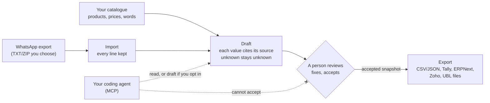

# ChatterPilot

**Turn a WhatsApp order export into drafts you can check, where every quantity and price cites the message or catalogue row it came from.**

For a shop that takes orders in a WhatsApp group and then retypes them into a spreadsheet, Tally or another billing tool. Also for a developer or coding agent who wants a small, tested starting point for that workflow. It runs on your computer. The core needs no account, no API key and no network.

Run a shop rather than code? Start with [docs/for-shops.md](docs/for-shops.md) and [docs/privacy.md](docs/privacy.md).

<p align="center">
  
</p>

## Quick start

Node.js 22.18 or later. Node 26 is not required. The third command turns on Corepack (it ships with Node 22) so pnpm 12 is available. If Corepack is disabled, install pnpm with `npm install -g pnpm@12` and run `pnpm install --frozen-lockfile && pnpm demo` instead.

```sh
git clone https://github.com/shekibahmed/ChatterPilot.git
cd ChatterPilot
corepack enable && corepack prepare pnpm@12.14.0 --activate && pnpm install --frozen-lockfile && pnpm demo
```

Open http://127.0.0.1:4317. The demo uses invented chats and an invented hardware-store catalogue ([fixtures/synthetic](fixtures/synthetic)). No Node on the machine? Open the repository in a dev container ([.devcontainer/devcontainer.json](.devcontainer/devcontainer.json)); it installs dependencies and runs the checks, then run `pnpm demo` inside it.

## What it is not

- Not a connection to WhatsApp. You choose an export file. Nothing is sent anywhere.
- Not piloted with a real business. Tests and the demo use synthetic data only. No time-saved or ROI claim is made.
- Not able to accept or submit an order by itself. A person does that. The MCP server has no accept or submit tool.
- Not a live bot, and it does not transcribe voice notes. A person can attach a transcript they already have.
- Not on npm yet. The `chatterpilot` package is ready to publish; until that release, start it from this clone. See [RELEASING.md](RELEASING.md).

## Walkthrough

**Watch the walkthrough** (about 4 minutes, invented data). There is also an [interactive tour](https://shekibahmed.github.io/ChatterPilot/media/tour.html) and a note on [how the videos are made](docs/media/README.md).

https://github.com/user-attachments/assets/8d0de102-f271-46f9-93e5-22ced205c35a

The problem and the design principles are in [docs/why.md](docs/why.md). The ten patterns, each with the test that proves it, are in [docs/patterns.md](docs/patterns.md). [docs/how-it-was-built.md](docs/how-it-was-built.md) is the method: research, small tested slices, held-out evaluation and review.

## How it works



Import keeps every line and refuses hostile ZIPs. Prices and tax come only from your catalogue. Unknown values stay unknown. Money is integer minor units. Exports read frozen accepted snapshots. Import files for Tally Prime, ERPNext, Zoho Books and UBL 2.1 are experimental: not yet tried in those products ([docs/exporters.md](docs/exporters.md)). The opt-in form filler types into a local synthetic form and stops before Submit ([docs/order-automation.md](docs/order-automation.md)).

## Use your own export

Only import chats you have the right to process. Workspaces live in `workspaces/` (ignored by Git).

```sh
pnpm chatterpilot init --timezone Asia/Kolkata --name "My shop"
pnpm chatterpilot catalogue check path/to/catalogue
pnpm chatterpilot catalogue load path/to/catalogue
pnpm chatterpilot import "WhatsApp Chat with Orders.zip"
pnpm chatterpilot serve
```

`parse` previews an export without storing it. `draft` prints suggestions in the terminal. `events` and `followups` are two other templates (fleet bookings, and open delivery or payment follow-ups). Catalogue columns are in [docs/catalogue.md](docs/catalogue.md). Order lines are tested in English and romanised Hindi, with digits in several Indic scripts. Other languages need a native speaker before anyone should trust them.

## Call it from an agent

The MCP server defaults to a **lite** profile: six read-only tools (`workspace_status`, `parse_export`, `list_suggestions`, `list_drafts`, `get_draft`, `dashboard`). **`--profile full`** adds the other eight, including import, catalogue load, creating a draft and proposing an edit. Fourteen tools in total. Still no accept, reject or submit.

Stdio, from this clone:

```sh
node apps/local/src/cli.ts mcp --workspace workspaces/default --files fixtures/synthetic --agent your-agent
```

Streamable HTTP (what a remote client such as xAI Grok can connect to). It binds to loopback unless you pass a token:

```sh
node apps/local/src/cli.ts mcp --transport http --port 4318
```

Endpoint: `http://127.0.0.1:4318/mcp`. Listening on any other address requires `--token`, sent as `Authorization: Bearer <token>`. This repository does not host a public URL.

After the npm release (not published yet):

```sh
npx chatterpilot --workspace workspaces/default --files .
```

Configs for Claude Code, Codex, Cursor and VS Code, and both profiles, are in [docs/harnesses.md](docs/harnesses.md). This repository's [`.mcp.json`](.mcp.json) opts into `--profile full` so an agent working in the clone can import and draft. The agent skill is [skills/whatsapp-operations/SKILL.md](skills/whatsapp-operations/SKILL.md), also copied to [.claude/skills/whatsapp-operations/SKILL.md](.claude/skills/whatsapp-operations/SKILL.md).

**If you are an agent:** start with [llms.txt](llms.txt) and [docs/agents/README.md](docs/agents/README.md). The full tool list is generated into [docs/agents/tools.json](docs/agents/tools.json).

## Build

```sh
pnpm check      # lint + typecheck + tests
pnpm test:e2e   # browser test of the demo
```

Packages are TypeScript source (no build step) except the publishable MCP bundle in `packages/mcp-server`, which is built when publishing. Layout and decisions: [DECISIONS.md](DECISIONS.md). What comes next: [docs/roadmap.md](docs/roadmap.md). Contributions: [CONTRIBUTING.md](CONTRIBUTING.md). A smaller first-look repository is sketched in [docs/launch/wa-order-draft-split.md](docs/launch/wa-order-draft-split.md). It has not been split out.

## Who builds this, and how can they help you?

ChatterPilot is designed and built by Shekib and [Kaamchor](https://bekaamchor.com). Kaamchor builds and deploys this for your Tally/ERP/WhatsApp workflow.

If you tried the demo and the shape matches how orders arrive in your shop, that conversation is the point of this repository:

- **Website:** [bekaamchor.com](https://bekaamchor.com)
- **Email:** [hello@bekaamchor.com](mailto:hello@bekaamchor.com)
- **WhatsApp:** [+91 84040 29692](https://wa.me/918404029692)
- **LinkedIn:** [linkedin.com/company/bekaamchor](https://www.linkedin.com/company/bekaamchor)

A good first message names the chat where orders arrive and the system they are retyped into. The data in this repository is synthetic, and nothing here has been piloted with a real business.

## Licence

MIT © 2026 Shekib Ahmed. See [LICENSE](LICENSE). Third-party packages keep their own licences; see [THIRD_PARTY_NOTICES.md](THIRD_PARTY_NOTICES.md).
